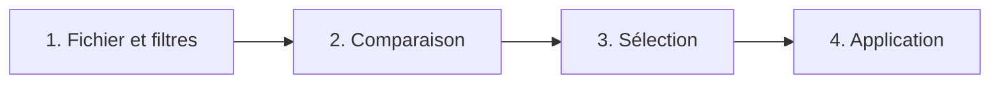

# Import de la configuration

## Description

Le contrôleur local reprend sa configuration (régions, opérateurs, satellites, profils, types de station, stations, slots) de RESASAT. RESASAT l'exporte dans un fichier JSON ; le contrôleur local le compare à sa propre base, laisse l'utilisateur choisir les modifications, puis les applique.

Ce document décrit les règles de l'import. L'écran est décrit dans [frontend](frontend.md), les routes et le code dans [backend](backend.md).

L'import se fait en quatre étapes :

## Fichier

Le fichier est celui que produit l'export de la configuration de RESASAT (fichier *resasat-configuration-AAAAMMJJ-HHMMSS.json*). Il contient :
* `format` : `resasat-configuration` ;
* `version` : 1 ;
* `date` : date de l'export, en secondes Unix ;
* `tables` : pour chaque table, `columns` (noms des colonnes) et `rows` (une liste de valeurs par enregistrement, dans l'ordre des colonnes). Les valeurs sont des chaînes ou `null`.

Le fichier est refusé en entier s'il n'est pas du JSON, si `format` est différent, si `version` est supérieure à 1, ou si une table importée est mal formée : nom de colonne incorrect, clé primaire absente, ligne de longueur différente, identifiant non entier ou présent deux fois. Sa taille est limitée à 64 Mo.

Les valeurs sont converties au type de la colonne dans le modèle de données ([database](database.md)) ; une chaîne vide vaut NULL, comme dans Oracle. Un enregistrement dont une valeur ne se convertit pas (du texte dans une colonne numérique) est signalé comme illisible : il n'est ni importé, ni proposé à la suppression.

Une colonne du fichier absente du modèle de données est ignorée et signalée.

## Tables importées

Huit tables, dans l'ordre de leurs dépendances :

| Table | Contenu |
| --- | --- |
| `resasat_region` | Régions |
| `resasat_operator` | Opérateurs |
| `resasat_satelite` | Satellites |
| `resasat_profile` | Profils |
| `resasat_station_type` | Types de station |
| `resasat_station` | Stations |
| `resasat_channel` | Slots |
| `resasat_st2c` | Slots supportés par type de station (table de liens) |

Deux tables de l'export ne sont jamais importées, même si le fichier les contient :
* `users` : données personnelles (noms, adresses électroniques, empreintes des mots de passe). Une référence à un utilisateur s'affiche par son seul identifiant, par exemple `#346` ;
* `resasat_s2c` : la compatibilité entre stations et slots passe par les types de station (`resasat_st2c`).

Toute autre table du fichier est ignorée. Les tables ignorées sont listées à l'étape de comparaison.

Une table importée absente du fichier n'est pas comparée : rien n'y est ajouté ni supprimé.

## Filtres

Deux filtres réduisent le fichier avant la comparaison. Ils se cumulent et sont actifs par défaut.

| Filtre | Choix par défaut | Autre choix |
| --- | --- | --- |
| Période | « Actifs et futurs » | « Tout » |
| Origine | « RESASAT seul » | « Tout » |

* **Actifs et futurs** : dans les tables qui ont une colonne `<table>_end` (satellites, profils, stations, slots), un enregistrement est écarté si sa date de fin est passée. Sans date de fin, il est gardé. L'instant de référence est celui du dépôt du fichier ; il est conservé pour que l'application calcule la même comparaison.
* **RESASAT seul** : dans les tables qui ont une colonne `<table>_is_foreign` (profils, stations, slots), un enregistrement est gardé si la valeur est 0 ou NULL. Les valeurs 1 (Globecast) et 2 (Rainbow) sont écartées. NULL est assimilé à 0, comme dans RESASAT.

Deux règles s'appliquent ensuite, quels que soient les filtres :
1. Un enregistrement écarté mais référencé par un enregistrement gardé est gardé aussi : par exemple un profil expiré encore utilisé par un slot actif. Aucune référence ne vise ainsi un enregistrement absent.
2. Un lien de `resasat_st2c` n'est gardé que si le type de station et le slot qu'il relie sont gardés. Un lien vers un slot absent du fichier est écarté, même sans filtre.

Le nombre d'enregistrements écartés est affiché pour chaque table.

Un enregistrement de la base locale qui n'est pas dans le fichier filtré est proposé à la suppression. Après un import sans filtre, un import avec filtres propose donc de supprimer les enregistrements expirés ou étrangers.

## Comparaison

Les enregistrements sont rapprochés par leur identifiant (clé primaire), puisque les clés étrangères restent numériques. Pour chaque table :
* **ajout** : l'identifiant est dans le fichier, pas dans la base ;
* **suppression** : l'identifiant est dans la base, pas dans le fichier ;
* **modification** : l'identifiant est des deux côtés et au moins un champ diffère. Seuls les champs qui diffèrent sont listés.

La comparaison est typée : `12700.30` et `12700.3` sont égaux, de même que `1` et `1.0`.

Libellés et valeurs sont présentés en français à partir du modèle de données :

| Élément | Présentation | Source dans le modèle |
| --- | --- | --- |
| Table, champ | Nom présenté aux utilisateurs de RESASAT | `comment` |
| Valeur NULL | « (vide) » | |
| Oui/non | « Oui », « Non » | `format: yes_no` |
| Date | Jour et heure, à l'heure de Paris : `31/12/2026 23:59` | `format: datetime` |
| Énumération | Libellé de la valeur ; « introuvable (valeur) » si elle est inconnue | `values` |
| Enregistrement lié | Nom de l'enregistrement ; « introuvable (#id) » s'il n'existe pas | `references` |
| Nombre décimal | Virgule décimale : `12700,3` | |

Le nom d'un enregistrement lié est cherché dans le fichier puis dans la base pour une valeur importée, dans la base seule pour une valeur actuelle.

Quand deux valeurs différentes se présentent de la même façon (deux dates qui diffèrent de quelques secondes), la valeur brute est ajoutée entre parenthèses.

Un enregistrement est désigné par son nom (colonne `<table>_name`) suivi de son identifiant, par exemple « Perm 1 (#10) ». Un lien est désigné par les noms des enregistrements qu'il relie : « DSNG → Perm 1 ».

## Sélection

* Une modification se coche champ par champ.
* Un ajout ou une suppression se coche par enregistrement.
* Les ajouts et les modifications sont cochés au départ ; les suppressions ne le sont pas.

Un enregistrement supprimé peut encore être référencé, par exemple par une réservation : c'est pourquoi les suppressions demandent un geste explicite.

## Application

À l'application, la comparaison est recalculée à partir du fichier gardé par le serveur et de l'état de la base à cet instant. La sélection envoyée par le navigateur ne contient que des désignations (table, action, identifiant, champ) :
* les valeurs écrites viennent toujours du fichier gardé par le serveur, jamais du formulaire ;
* une désignation qui ne correspond plus à un écart réel est ignorée, et le nombre de désignations ignorées est indiqué dans le compte rendu.

Les ajouts et les modifications sont faits dans l'ordre des tables ci-dessus, les suppressions dans l'ordre inverse.

Toutes les modifications sont faites dans une seule transaction. Si la base en refuse une, aucune n'est conservée : le message désigne l'enregistrement en cause et le fichier reste disponible pour une nouvelle sélection.

Après des ajouts, la séquence de la table est avancée au-delà du plus grand identifiant importé : un enregistrement créé ensuite localement ne reprend pas un identifiant de RESASAT.

Le compte rendu donne, par table, le nombre d'ajouts, de modifications et de suppressions. Le fichier gardé par le serveur est alors supprimé.
