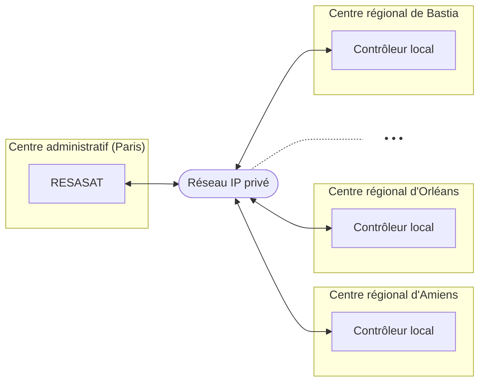

# Contrôleur local

## Description

Application destinée initialement pour simuler la version 2 des contrôleurs locaux, notamment le protocole INTERFACE_CONTROLLERV2 tel que décrit dans l'offre du 13/11/2026 faite à France Télévisions.

RESASAT est une application WEB écrite en PHP 8 + Oracle 19c. Elle est installée dans centre administratif de France Télévisions dans le 15ième arrondissement à Paris. Les contrôleurs locaux sont installés dans les centres régionaux répartis partout en France Métropolitaine et en Corse. RESASAT et les contrôleurs locaux communiquent à travers un réseau IP privé.



## La plateforme de développement et la plateforme cible

RedHat 9.6 afin de pouvoir faire tourner le simulateur sur la plateforme de développement de RESASAT. 

Frontend:
* TypeScript
* React

Backend:
* Python 3.11
* FastAPI
* Database: DuckDB (avec provision pour éventuellement supporter MariaDB et Oracle 19c les deux DB historiques de RESASAT)

Pour le datamodel de la base de données, on peut partir de celle de RESASAT accessible avec la commande suivante:
```
export ORACLE_HOME=/opt/oracle/product/19c/dbhome_1; /opt/oracle/product/19c/dbhome_1/bin/sqlplus resaora/${RESASAT_PASSWORD}@resasat-rhel96:1521/PDB1
```

Provision pour options à venir, mais sans compromettre la livraison du prototype:

* A terme, elle pourrait devenir l'application locale, voire un module d'une prochaine version de RESASAT.
* Support de plusieurs bases de données en plus de DuckDB: MariaDB, Oracle 19c ou plus récent.

## Liens

* [build](README.d/build.md), "Fabrication", décrit l'installation de l'environnement de développement et la procédure de fabrication.
* [database](README.d/database.md), "Base de données", décrit la base de données.
* [glossary](README.d/glossary.md), "Glossaire", définit et clarifie les termes techniques.
* [installation](README.d/installation.md), "Installation", décrit l'installation de l'environnement de production.
* [interface-resasat-local-controllerv2](README.d/interface-resasat-local-controllerv2.md), "interface entre RESASAT et les contrôleurs locaux, version 2", spécifie l'interface entre RESASAT et l'application des contrôleurs locaux.
* [translation](README.d/translation.md), "Traduction", donne la traduction des termes techniques en Français.

