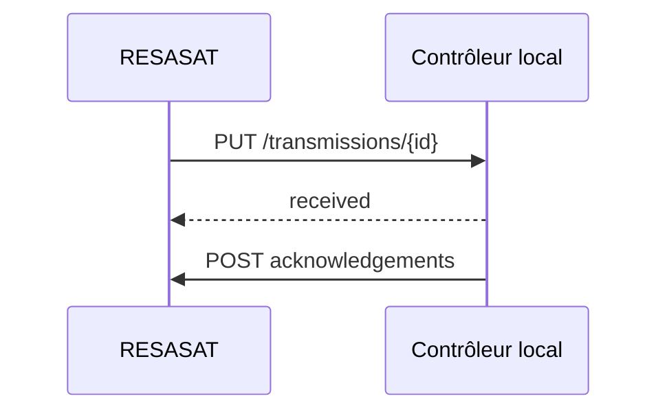
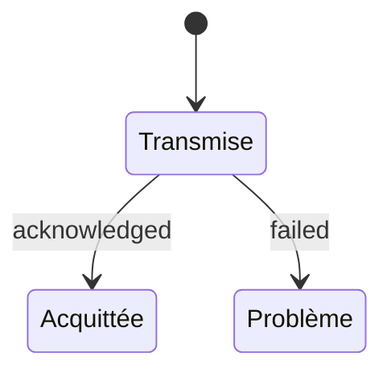

# Essai des schémas

Document d'essai pour *tools/export-to-pdf.py* : il n'est pas livré.

## Mermaid

## Drawio

## Formules

En ligne $P_{\text{PIRE}} = P_{\text{PAR}} + 2{,}15\text{ dB}$ et en bloc :

$$
\frac{C}{N_0} = \text{PIRE} - L_{fs} + \frac{G}{T} - 10\log_{10}(k)
$$

## Liens

Voir [la section Mermaid](#mermaid) et [un autre document](broken-diagram.md).
